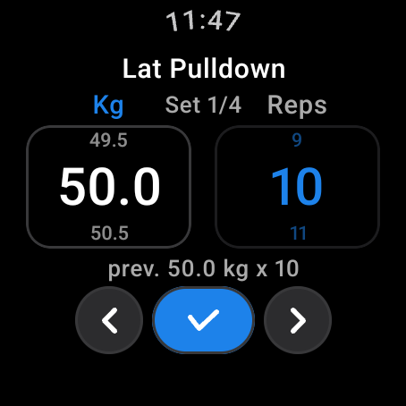
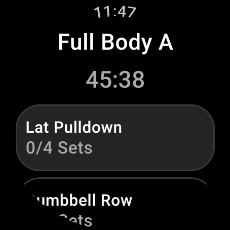
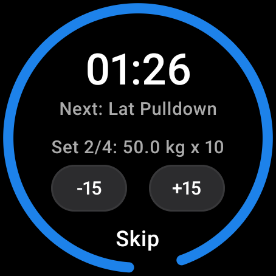

# openGym for Wear OS

A native Wear OS companion for [openGym](https://github.com/DuarteSantos8/openGym). The phone stays
the source of truth for a workout; the watch mirrors it live — current exercise, the set counter,
weight and reps you drive with the bezel, marking a set complete, and the rest timer. No WebView and
no Capacitor: the watch renders its own Compose for Wear OS UI.

| Exercise page | Workout page | Rest timer |
|---|---|---|
|  |  |  |
| Weight and reps per column, the crown drives whichever column is highlighted blue | Every exercise with its `done/total` sets; tap a row to make it current | Countdown ring, `-15` / `+15`, `Skip`, and the next set up |

## Requirements

- A Wear OS 3.0+ watch (`minSdk 30`). Built and tested against a Galaxy Watch 5 Pro.
- The **phone app must be the openGym build carrying the wear bridge**: `gustavompo/openGym`, branch
  `wear-bridge`. The watch is useless without it — the two are one product.
- The watch app and the phone app **must share the same `applicationId` and the same signing key**.
  The Wearable Data Layer matches on both, and silently does nothing when they differ.

## Install

1. **Signing key.** Both apps are signed with one shared keystore. Put a `keystore.properties` at the
   Gradle root (it is git-ignored, and a copy is never committed):

   ```properties
   storeFile=/path/to/opengym-wearos.jks
   storePassword=…
   keyAlias=opengym-wearos
   keyPassword=…
   ```

   The build works without it — `keystore.gradle` falls back to AGP's default debug key — but a build
   without the shared key will install and then never pair with the phone. That failure looks like a
   network bug and is not one.

2. **Build and install on the watch.**

   ```bash
   export JAVA_HOME=/path/to/jdk-21          # or set sdk.dir in local.properties for the SDK
   ./gradlew.bat :app:assembleDebug
   adb -s <watch-serial> install -r -d app/build/outputs/apk/debug/app-debug.apk
   adb -s <watch-serial> shell am start -n ch.duartesantos.opengym.test/ch.duartesantos.opengym.wear.MainActivity
   ```

   Without the phone, launch with the built-in fixture to see the UI on its own:

   ```bash
   adb -s <watch-serial> shell am start -n ch.duartesantos.opengym.test/ch.duartesantos.opengym.wear.MainActivity --es transport fake
   ```

   **`app-debug.apk` is not usable for daily wear.** A debug build is `debuggable` and skips R8, so
   every list scroll is visibly clunky — the UI looks broken in a way the same code is not. For a
   watch you actually wear, install the release build instead:

   ```bash
   ./gradlew.bat :app:assembleRelease
   adb -s <watch-serial> install -r -d app/build/outputs/apk/release/app-release.apk
   ```

   Release installs as `ch.duartesantos.opengym` (no `.test` suffix), which is the id the phone's
   release build uses. Same variant on both sides — see the pairing table below.

3. **Install the phone app** from the `wear-bridge` branch of the fork, building it the way that
   branch's own README describes. The applicationIds must line up:

   | Build type | `applicationId` (watch and phone) |
   |---|---|
   | `debug`, `benchmark` | `ch.duartesantos.opengym.test` |
   | `release` | `ch.duartesantos.opengym` |

   A debug watch app only pairs with a debug phone app. Mixing them is the most common way this
   appears broken.

## Build variants

| Variant | Signing / R8 | Use |
|---|---|---|
| `debug` | debuggable, no R8 | developing. **Never measure performance on it** — it costs ~30 ms more per frame, which is enough to make a smooth list look broken |
| `benchmark` | not debuggable, R8 on, `<profileable>` | measuring on the real watch. This is representative of what a user gets |
| `release` | not debuggable, R8 on | shipping and daily wear. Same code shape as `benchmark`, 23 MB of debug dex down to 2.6 MB |

## How the two sides talk

Primary path is the Wearable Data Layer (`link/DataLayerClient`, `OpenGymWearListenerService`). When
that is unavailable — no Google account, a sideloaded pair, an emulator — there is a TCP relay
fallback (`link/TcpRelayTransport`) for local testing. The wire contract is implemented in
`link/WireProtocol.kt`; the phone side mirrors it in `frontend/src/lib/wear-*.js` in the fork.

Weights cross the wire in **kilograms only**; the display unit (kg/lb) follows the phone's own setting
and is applied on each side (`data/WeightUnit.kt`), so unit changes never desynchronise the document.

## Layout

```
app/src/main/java/ch/duartesantos/opengym/wear/
├── MainActivity.kt              creates the repository, hosts WearApp
├── data/                        pure Kotlin, no android.* imports, fully unit-testable
│   ├── WorkoutState.kt          the projection the screens render
│   ├── WorkoutProjection.kt     set index, previous-set lookup, clamps
│   ├── WorkoutDocument.kt       ActiveWorkout / WorkoutExercise / WorkoutSet
│   ├── WorkoutRepository.kt     the interface + TimeSource
│   ├── FakeWorkoutRepository.kt in-memory implementation (the `fake` transport)
│   └── WeightUnit.kt            kg/lb display conversion
├── link/                        phone link: Data Layer client + TCP relay + wire protocol
├── navigation/Destination.kt    Destination + destinationFor(WorkoutState) — derived, never stored
├── theme/                       palette and type roles
└── ui/
    ├── WearApp.kt               AppScaffold and the three destinations
    ├── WearGeometry.kt          chord maths: the screen is a circle, not a rectangle
    ├── exercise/                the wheel page: ExercisePage, WheelDrag, ChordText, Haptics
    ├── workout/                 the list page: WorkoutPage, Haptics
    └── rest/                    RestTimer (ring) and RestSound
```

`ui/WearGeometry.kt` matters more than it looks: usable width is the **chord** of the circle at each
row's height, so text is constrained per row rather than to the screen width.

## Tests

```bash
./gradlew.bat :app:testDebugUnitTest                       # JVM: ~245 tests
./gradlew.bat :app:connectedDebugAndroidTest               # instrumented, needs a device
```

The JVM suite carries most of the weight — the ring geometry, the wheel, the protocol and the
projection are all pure functions. Pin `ANDROID_SERIAL` for the instrumented run if more than one
device is attached; `connectedDebugAndroidTest` targets every device it finds and uninstalls afterwards.
